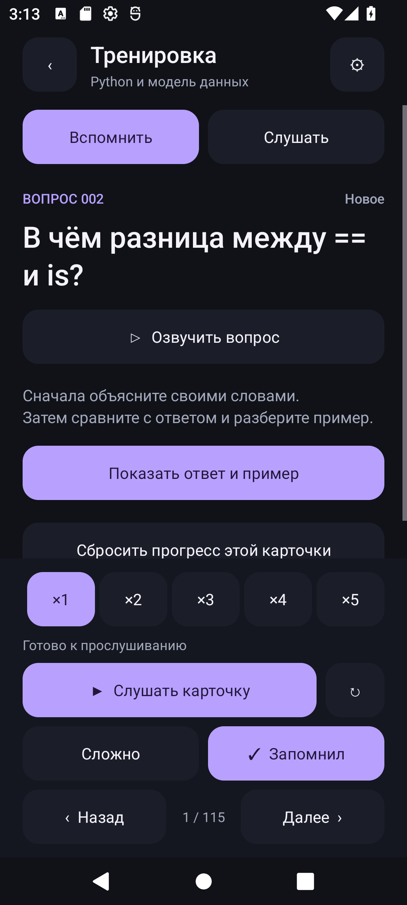
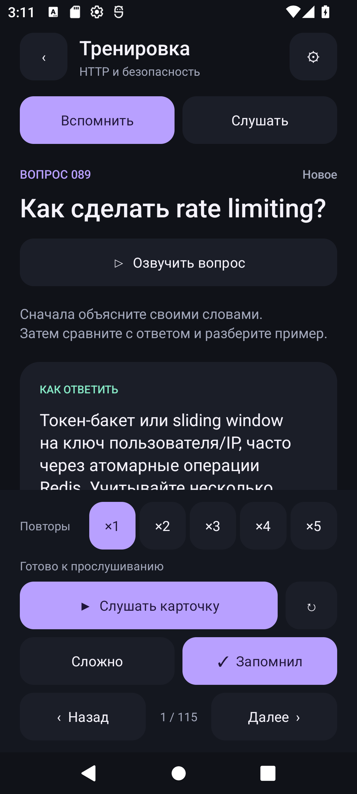
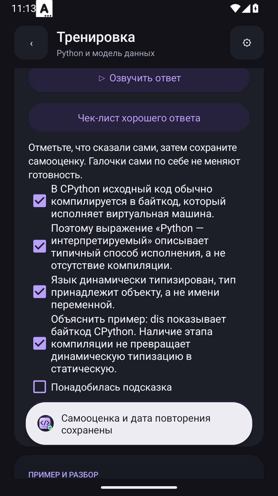
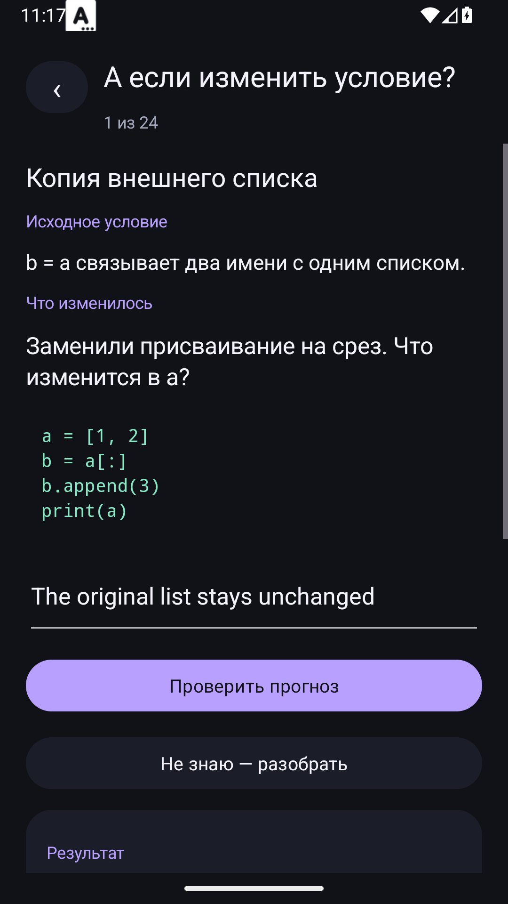
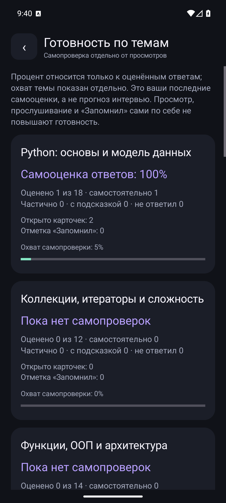
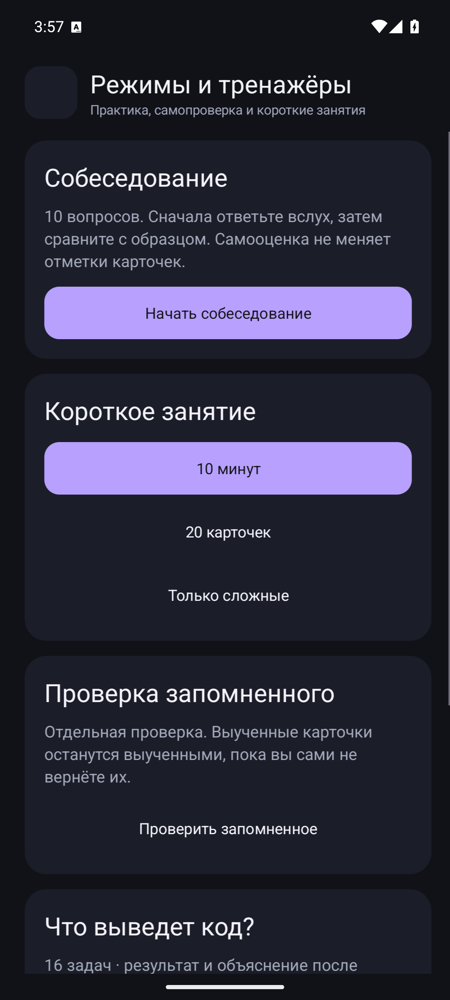
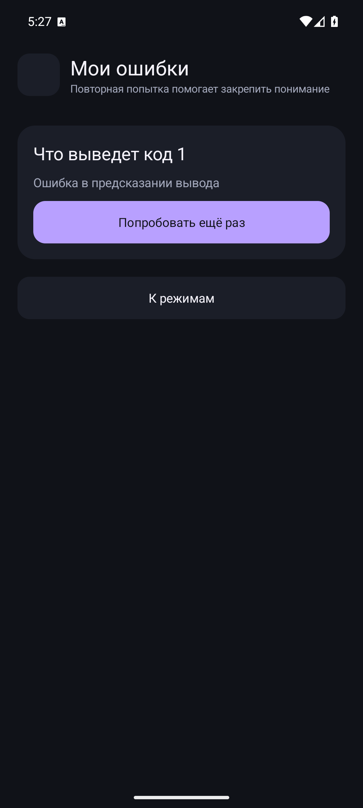

# Tech Interview Prep: Python (Middle) 🐍📱

[-brightgreen?logo=android)](https://developer.android.com/)
[](https://kotlinlang.org/)
[](https://python.org/)
[]()
[]()
[]()

**Tech Interview Prep: Python** — нативный офлайн-тренажёр технического собеседования на Android для разработчиков уровня Python Middle / Middle+.

Приложение содержит **155 структурированных вопросов** по 13 ключевым темам бэкенд-разработки, **706 MP3-аудиодорожек** с озвучкой вопросов, коротких и подробных ответов мужским голосом (Andrew Multilingual), интерактивные задачи по Python и SQL, чек-листы самопроверки, алгоритм интервального повторения и фоновый плеер.

---

## 📸 Скриншоты

| Главный экран | Вопрос карточки | Ответ и разбор |
| :---: | :---: | :---: |
|  |  |  |

| Чек-лист критериев | Сценарии «А если изменить?» | Готовность по темам |
| :---: | :---: | :---: |
|  |  |  |

| Режимы и тренажёры | Работа над ошибками |
| :---: | :---: |
|  |  |

---

## 🎯 Основные возможности

### 1. Учебные карточки и база знаний
- **155 тем и вопросов** по 13 разделам:
  - **Core Python**: модель данных, GIL, Garbage Collector, генераторы, декораторы, дескрипторы, метаклассы.
  - **Структуры данных & Collections**: списки, словари, хеш-таблицы, множества, временная сложность.
  - **ООП и паттерны**: наследование, MRO, SOLID, абстрактные классы, протоколы.
  - **Concurrency & Asyncio**: потоки, процессы, asyncio event loop, таски, футуры, пулы воркеров.
  - **Базы данных & SQL**: уровни изоляции транзакций, блокировки, индексы, оптимизация запросов.
  - **ORM & Миграции**: SQLAlchemy, Alembic, Django ORM (select_related, prefetch_related, N+1 problem).
  - **Web Frameworks**: FastAPI (DI, Pydantic v2, ASGI), Django (Middleware, Signals, MVT).
  - **Архитектура & System Design**: кэширование, очереди задач, микросервисы, идемпотентность, масштабирование.
  - **Тестирование & Best Practices**: pytest, фикстуры, моки, профилирование кода.

### 2. Ступенчатая озвучка и уровни ответов
- **706 студийных аудиозаписей** (мужской голос Andrew Multilingual).
- Два уровня ответа для каждой карточки:
  - **Короткий ответ**: ключевые тезисы для быстрого ответа на собеседовании (медиана 20.2 с).
  - **Подробный ответ**: развёрнутое объяснение, пример кода и понятная аналогия из жизни (медиана 45.1 с).
- Отдельные кнопки воспроизведения вопроса, ответа, примера и аналогии.

### 3. Интервальное повторение («Повторить сегодня»)
- Умная очередь повторений (до 20 вопросов за сессию).
- Адаптивные интервалы по результатам самооценки:
  - ❌ Ошибка — повтор через 10 минут.
  - ⚠️ Частичный ответ / с подсказкой — повтор через 1 день.
  -  Уверенный ответ — увеличение интервала (1, 3, 7, 14, 30 дней).
- Запомненные карточки (`LEARNED`) по умолчанию исключаются и не перегружают очередь.

### 4. Чек-листы критериев ответа
- 3–5 чётких критериев для каждого из 155 вопросов.
- Пользователь формулирует ответ вслух, открывает чек-лист и отмечает озвученные тезисы.
- Объективная самооценка: все пункты = успешно, часть/подсказка = частично, ничего = ошибка.

### 5. Интерактивные тренажёры
- **«А если изменить условие?»**: 24 сценария с изменением контекста задачи (прогноз поведения, скрытый разбор и аудио).
- **Сравнение концепций**: 12 пар терминов (отличия, когда выбирать, частые ловушки).
- **Практика кода (Python)**: 16 задач на проверку алгоритмов и идиом языка.
- **SQL-тренажёр**: 15 интерактивных запросов на SQLite с проверкой граничных случаев (NULL, пустые таблицы, дубликаты).
- **Собеседование с таймером**: имитация реального интервью (30, 60, 90 секунд на ответ).

### 6. Фоновый плеер и мобильность
- Режим «Слушать без остановки»: фоновое воспроизведение через `MediaSession` при заблокированном экране.
- Управление из шторки уведомлений и с экрана блокировки (пауза, перемотка ±10 с, повтор фразы).
- Запись своего ответа через микрофон с локальным сохранением и прослушиванием.

### 7. Приватность и сохранность данных
- **100% Offline**: приложению не требуется разрешение `INTERNET`. Никакой рекламы, трекеров и телеметрии.
- Сохранение прогресса в `Jetpack DataStore`.
- Функция **«Продолжить с места остановки»**: сохранение черновиков, текущего вопроса, аудиопозиции и состояния очереди.
- Экспорт и импорт прогресса в формате JSON через системный Storage Access Framework.

---

## 🛠 Технологический стек

### Android
- **Язык**: Kotlin 2.0.21
- **Минимальная версия**: Android 10 (API 29)
- **Целевая версия**: Android 15 (API 35)
- **Архитектура**: Clean UI / State-driven, Model-Controller
- **Компоненты**:
  - Material Components for Android 1.12.0
  - Jetpack DataStore Preferences
  - Kotlin Coroutines & Flow
  - Android Media & MediaPlayer with MediaSessionCompat
  - SQLite Database Engine

### Python & Инструментарий
- **Язык**: Python 3.10+
- **Синтез аудио**: Microsoft Edge TTS (`edge-tts`)
- **Верификация данных**: валидация синтаксиса примеров, проверка SQLite схем и тестовых наборов
- **Управление зависимостями**: `requirements.txt`, `requirements-lock.txt`

---

## 📂 Структура проекта

```text
tech-interview-prep-py/
├── android/                         # Исходный код Android-приложения
│   ├── app/
│   │   ├── src/main/java/           # Kotlin исходники (UI, плеер, база, логика)
│   │   ├── src/main/res/            # Разметка XML, векторные иконки, темы
│   │   └── src/main/assets/         # Встроенные JSON-данные и аудиофайлы
│   ├── build.gradle.kts             # Конфигурация корневого Gradle
│   └── gradlew                      # Gradle Wrapper скрипт
├── data/                            # Исходные файлы данных и учебных материалов
│   ├── cards.json                   # 155 базовых карточек
│   ├── learning_v5.json             # Дополнения v5: чек-листы, уровни ответов
│   ├── exercises.json               # Задачи по коду и SQL
│   ├── analogies.json               # Аналогии для концепций
│   └── v5_tracks.json               # Манифест подробных аудиодорожек
├── audio/                           # 706 MP3-файлов озвучки вопросов и ответов
├── scripts/                         # Python-скрипты генерации, проверки и сборки контента
│   ├── check_v5_content.py          # Комплексная проверка контента и аудиофайлов
│   ├── build_v5_content.py          # Сборка объединённого пакета для Android
│   ├── build_sql_checks.py          # Верификация SQL-задач на SQLite
│   └── generate_audio.py            # Возобновляемый синтез голоса
├── docs/                            # Технические спецификации, отчёты и скриншоты
│   ├── screenshots/                 # Скриншоты экранов приложения
│   ├── TECH_SPEC_V5.md              # ТЗ актуальной версии
│   └── V5_REPORT.md                 # Отчёт о реализации и тестировании
└── README.md                        # Документация проекта
```

---

## 🚀 Сборка и запуск

### Предварительные требования
1. **JDK 17** (`openjdk-17-jdk` или аналог)
2. **Android SDK** (Platforms 35, Build-tools 35.0.0)
3. Установленная переменная окружения `ANDROID_HOME` (либо путь в `android/local.properties`)

### Сборка Android APK
```bash
# Клонирование репозитория
git clone git@github.com:miazigoo/tech-interview-prep-py.git
cd tech-interview-prep-py

# Сборка отладочной версии
./android/gradlew -p android assembleDebug

# Запуск юнит-тестов и линтера
./android/gradlew -p android testDebugUnitTest lintDebug
```

Собранный файл будет находиться по пути:
`android/app/build/outputs/apk/debug/app-debug.apk`

### Установка на устройство или эмулятор
```bash
# Установка APK через ADB
adb install -r android/app/build/outputs/apk/debug/app-debug.apk

# Запуск приложения
adb shell am start -n com.python.interviewcards/.MainActivity
```

---

## 🧪 Запуск проверок контента (Python)

Для проверки валидности данных, синтаксиса примеров кода и аудиоманифестов:

```bash
# Настройка виртуального окружения
python3 -m venv .venv
source .venv/bin/activate
pip install -r requirements.txt

# Проверка контента и примеров
python3 scripts/check_v5_content.py

# Проверка и выполнение тестовых SQL-запросов
python3 scripts/build_sql_checks.py
```

---

## 📄 Лицензия

Проект распространяется под лицензией [MIT](LICENSE).
Материалы и вопросы предназначены для подготовки к собеседованиям и самообразования.
